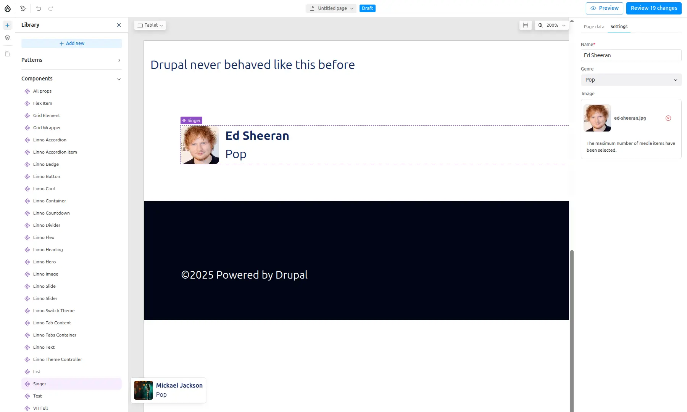

Because Drupal Canvas is ambitious, what about building your own Spotify
interface ?

## Let's start with a singer SDC
---

Inside your custom theme, create a folder for your new SDC.
- Inside a `components/` folder, create a `singer/` folder, your new **Single
Directory Component!**

This directory should contain at least:
- `singer.component.yml` that defines the SDC's **metadata**:
  optional props and slots.
- `singer.twig` that defines the markup.

Optionally in the same folder add:
- `singer.css` for **styling**
- `singer.js` for any **behaviors**.
- Extra **assets**: images, svg icons, fonts, etc.
- `README.md` file for documentation.

ℹ️ Required **Drupal libraries**, should be defined in the `libraryOverrides`
section of the `singer.component.yml` file.

### Structure

```
my_theme/
└── components/
    └── singer/
        ├── singer.component.yml
        ├── singer.twig
        ├── singer.css
        └── micro.jpg
```

### Props

Our SDC defines 3 content props or inputs:
- `name` of the singer, simple **string**,
- `image` of the artist, **image object**
- `genre` of music, picked among list of predefined strings

[Further details about props.](sdc-components/props)

### Metadata

Here how the metadata could be defined:

```yaml
# singer.component.yml
'$schema': 'https://git.drupalcode.org/project/drupal/-/raw/HEAD/core/assets/schemas/v1/metadata.schema.json'
name: Singer
status: stable
group: Music
description: Singer component, could be used to display one singer.
props:
  type: object
  required:
    - name
  properties:
    name:
      type: string
      title: Name
      description: Name of the singer.
      examples: ['Michael Jackson','Bruno Mars']
    genre:
      type: string
      title: Genre
      description: Main music Genre of the singer
      enum:
        - Pop
        - Jazz
        - Soul
        - Funk
        - "Rock and Roll"
        - Electro
      examples: ['Pop']
    image:
       $ref: json-schema-definitions://canvas.module/image
      type: object
      title: Image
      description: >
        Image of the singer
      examples:
        - src: 'micro.webp'
          alt: 'Nice picture of the singer'
          width: 200
          height: 300
```

You can use this image for the default image of a new Singer


### TWIG: Let's add some markup

```twig
{# singer.twig #}
<div class="singer">
  
  <div>
    <h3 class="singer-name">{{ name }}</h3>
    <div class="singer-genre">{{ genre }}</div>
  </div>
</div>
```

### CSS: Let's add some styling.

```css
/* singer.css */
.singer {
  display: flex;
  align-items: center;
  gap: 0.5rem;
}
.singer-image {
  height: 50px;  width: 50px;
  object-fit: cover;
  border-radius: 6px;
}
.singer-name { font-weight: bold; }
.singer-genre { font-weight: normal; }
```

## Ready to drag !
---
1. Our component `Singer` is ready to be used, just drag it to the Canvas.
- ℹ️ Oh ! Hovering your new SDC in the sidebar,
displays a nice preview with [default values of your props](sdc-components/validations#default-values).
- ℹ️ Pay attention, your new singer SDC is under the "Music" group. (`group: Music` in the metadata)
2. You can insert your favorite singer, with a nice picture.



## Many favorite singers
---
But I have more than one favorite singer !

>💡 [Slots](sdc-components/slots) are here to help !
