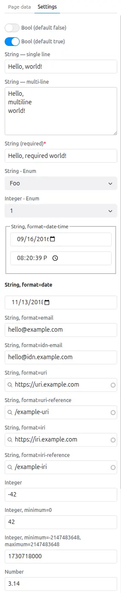
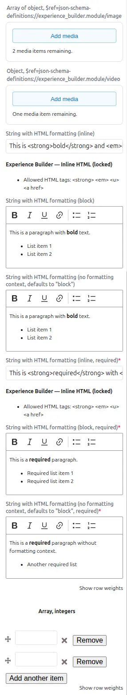

Props allow the component to define inputs.

Those inputs could be used by editor to:

- Insert content
  - Set the text of a badge,
  - Set the image of a card...

- Configure the appearance of a SDC
  - Change the color of a badge,
  - Set text alignment,
  - Set state of a tab to active,
  - Apply animations...


Each prop can specify its type and the widget used when editing this prop.

## Prop types

1. **string**: A simple text input.
2. **number**: A numeric input.
3. **boolean**: A checkbox input.
4. **object**: A complex input that can contain multiple properties.
5. **array**: A list of items, each of which can be a string, number, or object.

## Formats & Widgets

According to the prop options, Drupal Canvas will use a different widgets
to render the prop input in the sidebar:

- **Boolean** props will be rendered as a `HTML checkbox`,
- **string** prop has several widgets, by specifying `format`, `$ref` and other
  additional properties (like `contentMediaType` for text/html)
  - Simple text input,
  - `Textarea` with or without `CKEditor`
  - `Dropdown` with a predefined list of options, using `enum` and `meta:enum`
    properties,
  - `Date`, `time`, `duration` picker,
  - `Link` picker with auto-completion...
- **number** has several widgets
  - Simple input with type="number",
  - `Dropdown` with a predefined list of numbers...
- **object** props can be rendered as a form with multiple fields, each field
  corresponding to a property of the object. Ex: image with alt text, title,
  caption, etc.
- **array** props can be rendered as a list of items, each item can be a string,
  number, or object. The user can add or remove items from the list.

Example of dropdown, using `enum`.
- ℹ️ `meta:enum` is optional, it allows you to rewrite the values shown in the
dropdown. It also allows you to have translation capability on those strings.

```yaml
    test_string_enum:
      title: 'String - Enum'
      type: string
      enum:
        - foo
        - bar
      meta:enum:
        foo: Foo
        bar: Bar
```

To get an overview of most available types and corresponding widgets,
see the sub test module: **"All-Props" Test SDC**.



