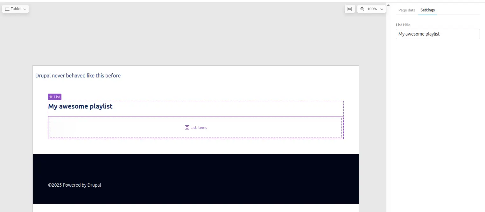
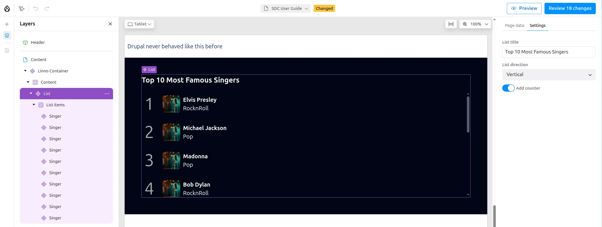
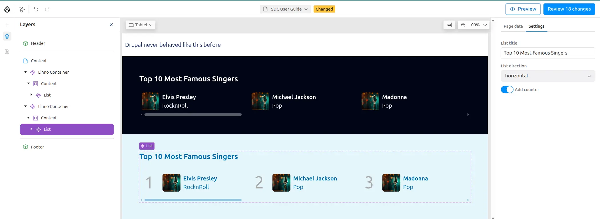

A slot is a region which allows to place other components.

For example a SDC `List` define a slot called `Items`, that will accepts
any other SDC, and each of them will be displayed as a list item.

## SDC with slot

What about making a **list of your favorite artists** !
So you need a new SDC that will play the role of a container, where you will be
able to add all your favorite `Singers`.

```
my_theme/
└── components/
    └── list/
        ├── list.component.yml
        ├── list.twig
        └── list.css
```

### Structure
- A **prop** `title` to show the name of the list
- A **slot** `content` to list your singers

To define a slot, add it under the `slots` key. You can add multiple.

ℹ️ This SDC `List` is generic, so could list anything, not only Singers !

### Metadata

`SDC List` contains one prop and one slot.

```yaml
# list.component.yml
'$schema': 'https://git.drupalcode.org/project/drupal/-/raw/HEAD/core/assets/schemas/v1/metadata.schema.json'
name: List
status: stable
description: List component, displays sdc children as a vertical numbered list.
props:
  type: object
  properties:
    title:
      type: string
      title: List title
      description: >
        Title of the list
      examples: ["My awesome list"]
slots:
  content:
    title: List items
    description: >
      Place any SDC in this slot, to add them to the list.
```

ℹ️ The `title` key of each slot will be used as the **placeholder** in the Canvas.



### Markup

Let's add some markup in the **TWIG**,

- ℹ️ use unique class for each section to ease the styling.
- ℹ️ It's recommended to use BEM methodology to avoid css collision

```twig
{# list.twig #}
<div class="sdc-list">
  <h2 class="list-title">{{ title }}</h2>
  <div class="list-items {{ classes }}">
    {{ content }}
  </div>
</div>
```

### Styling

Let's add some CSS:

- The list will be vertical
- An automatic scrollbar when many items

```css
/* list.css */
.list-title {
  font-size: 1.3rem;
  font-weight: 700;
  margin-block-end: 1rem;
}

.list-items {
  display: flex;
  gap: .5rem;
  counter-reset: list-number;
  flex-direction: column;
  max-block-size: 300px;
  overflow-y: auto;
  & > *:hover {
    background-color: lightgrey;;
  }
}
```

## Horizontal List

Our list component is pretty nice, but what about making it awesome ?
**Challenge accepted !**

Let's add some props, not to add more content, but to change the SDC appearance
this time:

- Display the list horizontally or vertically
- Display an optional Counter

```yaml
# list.component.yml
...
direction:
  type: string
  title: List direction
  enum: ['vertical','horizontal']
  meta:enum:
    vertical: Vertical
    horizontal: horizontal
  examples: ['vertical']
with_counter:
  type: boolean
  title: Add counter
  description: Add a number to each list item
  examples: [false]
```

Here is one way to add multiple css classes according prop values:

```twig
{# list.twig #}


<div class="sdc-list">
  <h2 class="list-title">{{ title }}</h2>
  <div class="list-items {{ classes }}">
    {{ content }}
  </div>
</div>
```

And let's add more CSS for our new props

```css
/* list.css */
...
.list-direction-horizontal {
  flex-direction: row;
  overflow-x: auto;

  &>* {
    flex-shrink: 0;
    flex-basis: 300px;
    padding: 6px;
  }
}
.list-with-counter >* {
  counter-increment: list-number;
  &:before {
    font-size: 3rem;
    color: darkgrey;
    content: counter(list-number);
    padding-inline: .5rem;
    margin-inline-end: .5rem;
  }
}
```

## Let's create Our top 5

Congratulation, your new SDC `List` has super powers and is ready to received as
many singers that you like !

5 wasn't enough, I added 10.



Some horizontal variations with and without counter



Hum, in fact I lied, it's not my top 10, but the 10 most famous singers
according AI.

**What ???** How did you do that ?

See you in next chapter to learn how to use [Canvas with AI](ai)


